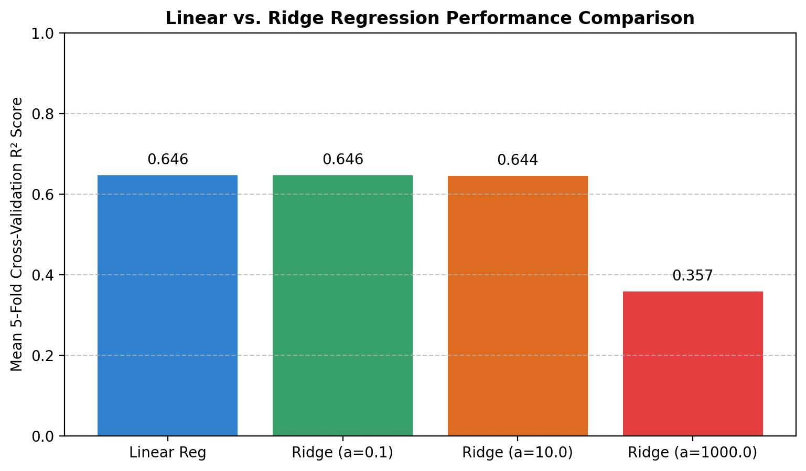
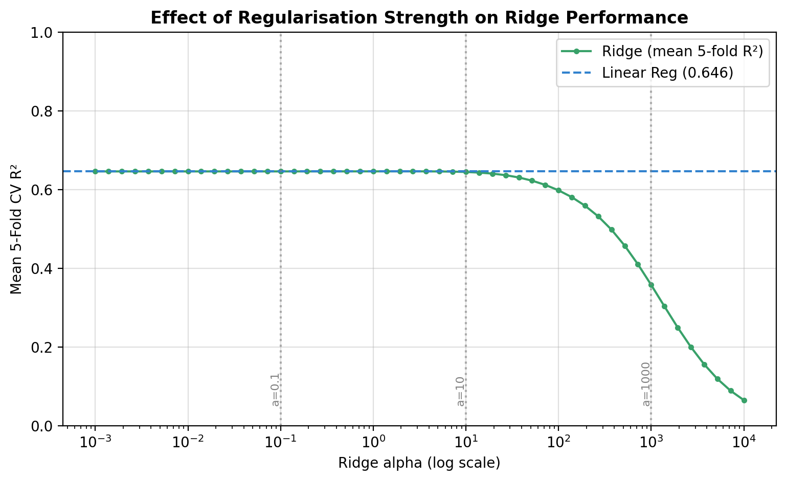
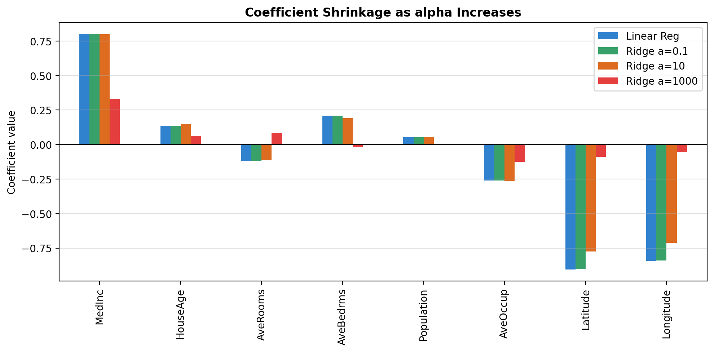

# SC5002 Lab Assignment — Search Algorithms & Regularised Regression

**Course:** SC5002 Artificial Intelligence Fundamentals & Applications, Nanyang Technological University

**Author:** YU XIYAO U2440309D

**Semester:** AY2026/27 Semester 1

This repository contains the practical component (Part 2) of the SC5002 lab assignment: a comparison of
Linear Regression and Ridge Regression on the California Housing dataset, evaluated with 5-fold
cross-validation. The hand calculations for Part 1 (BFS, A* search and the 8-puzzle) and all
"Learn with AI" prompt logs are in the PDF report submitted on NTULearn.

---

## Repository contents

| File | Description |
|---|---|
| `SC5002_Part2_Regression.ipynb` | Colab notebook: template Cells 1–3 (Tasks 2.1–2.3) plus extension Cells 4–8 |
| `model_comparison.png` | Task 2.3 bar chart: mean 5-fold CV R² for each model |
| `alpha_sweep.png` | Extension: CV R² across 50 values of α from 0.001 to 10,000 |
| `coefficient_shrinkage.png` | Extension: how each feature's coefficient shrinks as α grows |
| `README.md` | This file |

---

## How to run

1. Open [Google Colab](https://colab.research.google.com) → **File → Upload notebook** → choose `SC5002_Part2_Regression.ipynb`
   (or open it directly from this repository via **File → Open notebook → GitHub**).
2. **Runtime → Run all.** No installation is needed; all libraries are pre-installed in Colab.
3. Total runtime is under one minute. Charts are displayed inline and saved as PNG files in the Colab session.

**Environment:** Python 3, scikit-learn, pandas, NumPy, Matplotlib (Colab defaults).
All randomness uses `random_state=42`, so results are reproducible.

---

## Dataset

The [California Housing dataset](https://scikit-learn.org/stable/modules/generated/sklearn.datasets.fetch_california_housing.html)
comes from the 1990 US Census. Each row is one census block group (a district). A random sample of
1,000 of the 20,640 rows is used.

| Variable | Role | Meaning |
|---|---|---|
| `MedHouseVal` | **Target** (continuous) | Median house value, in units of $100,000 |
| `MedInc` | Feature | Median household income (units of $10,000) |
| `HouseAge` | Feature | Median age of houses in the district (years) |
| `AveRooms` | Feature | Average rooms per household |
| `AveBedrms` | Feature | Average bedrooms per household |
| `Population` | Feature | District population |
| `AveOccup` | Feature | Average household size |
| `Latitude` | Feature | District latitude |
| `Longitude` | Feature | District longitude |

Note: house values are capped at 5.00001 ($500,000+) in the source data.

---

## Method

1. **Scaling** — all 8 features are standardised to mean 0 and standard deviation 1 with `StandardScaler`.
   Without this, features measured in thousands (`Population`) would dominate features near 1 (`AveBedrms`),
   and Ridge's penalty would treat them unequally.
2. **Split** — 80% training (800 rows), 20% test (200 rows).
3. **Models** — Linear Regression (no penalty) and Ridge Regression with α ∈ {0.1, 10, 1000}.
   Ridge minimises prediction error *plus* α × (sum of squared coefficients), so larger α forces a simpler model.
4. **Evaluation** — 5-fold cross-validation R² on the training set. R² = 1 is perfect; R² = 0 is no better
   than always predicting the average house value.

---

## Results

### Task 2.2 — Mean 5-fold cross-validation R²

| Model | Mean CV R² | Std across folds |
|---|---|---|
| Linear Regression | **0.6457** | 0.060 |
| Ridge (α = 0.1) | 0.6457 | 0.060 |
| Ridge (α = 10) | 0.6443 | 0.059 |
| Ridge (α = 1000) | 0.3574 | 0.041 |

> Replace with the numbers from your own Colab run if they differ.

### Key findings

- **Light regularisation changes nothing here.** Ridge with α = 0.1 is identical to Linear Regression, and
  α = 10 is marginally lower. With 800 rows and only 8 features, the unregularised model is not overfitting,
  so there is nothing for the penalty to correct.
- **Heavy regularisation causes underfitting.** At α = 1000, R² falls from 0.65 to 0.36. The penalty
  shrinks the total size of the coefficients by about 77%, so the model can no longer capture real
  relationships such as income → house price.
- **A single train/test split would be unreliable.** The same Linear Regression model scored anywhere from
  0.602 to 0.749 depending on which fold was held out. Cross-validation averages over five splits, so the
  reported score does not depend on one lucky or unlucky draw.

---

## Extension experiments (Cells 4–8)

| Cell | Question | Finding |
|---|---|---|
| 4 | How much do individual folds vary? | Linear Regression fold scores span 0.148 R² — the case for cross-validation |
| 5 | Where is the best α? | The curve is flat up to α ≈ 10, peaks at α ≈ 1.9 (R² 0.6459, negligible gain), then drops steeply |
| 6 | What does α do to the model? | At α = 1000, `Latitude` and `Longitude` shrink from about −0.9 to under −0.1 — location information is largely discarded |
| 7 | Does scaling before splitting leak information? | Yes in principle; fitting the scaler inside each fold changes R² by at most 0.003 here |
| 8 | How do models score on the untouched test set? | Linear 0.662, Ridge α=10 0.658, Ridge α=1000 0.401 — consistent with cross-validation |

---

## Changes made to the provided template

The template code was copied from the assignment PDF. Three copy-paste errors had to be fixed before it would run:

1. A `print(f"...")` statement inside the Ridge loop was split across two lines, causing
   `SyntaxError: unterminated string literal`. Joined into one line.
2. Indentation inside both `for` loops was lost in the PDF, causing `IndentationError`. Restored.
3. A stray leading space before `plt.show()` caused `IndentationError`. Removed.

Additions that do not change the template's results: `pd.set_option` for wider printing, storing per-fold
scores in `ridge_fold_scores`, and `plt.savefig(...)` to export the chart.

[Describe briefly how you used GenAI to diagnose these errors.]

---

## Use of Generative AI

[Name the AI tool(s) you used, e.g. ChatGPT / Gemini / Claude.] Generative AI was used as a learning
partner, as required by the assignment: to explain concepts (admissible heuristics, feature scaling,
regularisation, cross-validation), to check hand calculations for the 8-puzzle, and to debug the
template code. Full prompts and reflections are in the PDF report.

[Add 2–3 sentences in your own words on what the AI helped you understand and where you had to correct or verify it.]

---

## Limitations

- Only 1,000 of 20,640 rows are used, so scores may differ from those on the full dataset.
- Linear models cannot capture non-linear patterns (e.g. the price ceiling at $500,000, or coastal location effects);
  tree-based models would likely score higher.
- The scaler is fit before the train/test split (template design). Cell 7 shows the effect is negligible here,
  but a `Pipeline` is the correct practice.
